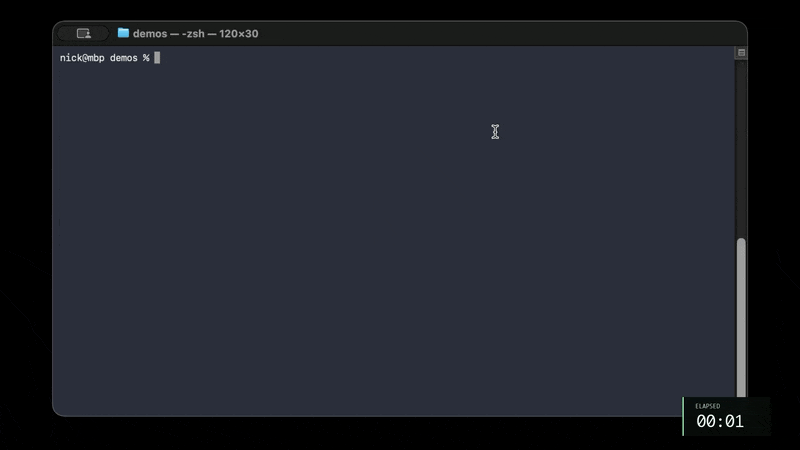
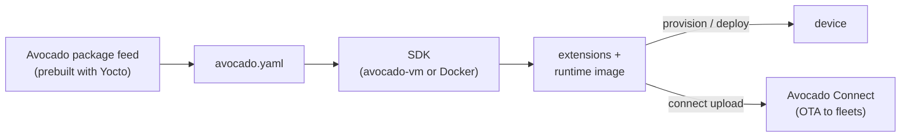

<p align="center">
  <picture>
    <source media="(prefers-color-scheme: dark)" srcset=".github/assets/avocado-cli-banner-dark.png">
    
  </picture>
</p>

<div align="center">

**Build fast. Ship secure. Custom, production-ready embedded Linux for the edge, from one `avocado.yaml`.**

One CLI to build [Avocado OS](https://docs.peridio.com/avocado-os/about) images, provision devices, and ship OTA updates.

[](https://github.com/avocado-linux/avocado-cli/releases)
[](https://github.com/avocado-linux/avocado-cli/blob/main/LICENSE)
[](https://docs.peridio.com/developer-reference/avocado-cli/overview)
[](https://www.peridio.com/join-our-discord)

[Quickstart](#quickstart) · [Install](#install) · [Hardware](#supported-hardware) · [Ecosystem](#the-avocado-ecosystem) · [Advanced topics](#advanced-topics) · [Agentic development](#agentic-development) · [FAQ](#faq) · [Documentation](https://docs.peridio.com/developer-reference/avocado-cli/overview) · [Downloads](https://www.peridio.com/downloads#cli-artifacts)

</div>

## What is Avocado OS?

Avocado OS is an immutable embedded Linux distribution built on top of Yocto. We run the BitBake builds for your hardware ahead of time and publish the output as RPM package feeds. We prebuild:

- Kernel and kernel modules
- Board support package (BSP)
- Rootfs and initramfs packages
- Libraries and userspace packages
- SDK toolchain for cross-compilation

You select what you need in `avocado.yaml`. The CLI installs these prebuilt packages and assembles the kernel image, initramfs, and rootfs into an OS image. The OS is assembled at build time, not at run time.

Because everything is prebuilt, you get:

- **Fast builds.** You do not run BitBake or wait for multi-hour builds.
- **No build server.** An everyday laptop is enough to assemble a full OS image.
- **Hardware portability.** To move to different hardware, simply change the target in `avocado.yaml`.
- **One-line packages.** To add a package, search our feeds and add it to your `avocado.yaml`.
- **Fast iteration.** Push an updated extension to a running device on your network with `avocado deploy`.
- **Reproducible.** Versioned package feeds and `avocado.lock` pin every package, so the same `avocado.yaml` and lockfile install the same package versions every time, and every device runs what you tested.

Your application goes in extensions, so you can update it without a rebuild of the OS or a reboot. OS updates use A/B partitions with automatic rollback. Avocado OS also supports [secure boot](https://docs.peridio.com/avocado-os/security/secure-boot) and [encrypted storage](https://docs.peridio.com/avocado-os/security/encryption).

See [About Avocado OS](https://docs.peridio.com/avocado-os/about) for more info.

## What is the Avocado CLI?

The Avocado CLI is a cross-platform tool written in Rust. It orchestrates everything you need to build and ship Avocado OS, on your machine or in CI. With the CLI, you can:

- **Start a project** for a hardware target or from a [reference project](https://github.com/avocado-linux/references) (`avocado init`)
- **Install** the SDK toolchain and packages from the Avocado package feeds (`avocado install`, `avocado fetch`)
- **Build** your system extensions and the runtime image (`avocado build`)
- **Provision** a bootable image for a device (`avocado provision`)
- **Generate an SBOM** in SPDX 3.0 format for the installed packages (`avocado sbom`)
- **Ship updates** through [Avocado Connect](https://docs.peridio.com/avocado-connect/overview) (`avocado connect upload`, `avocado connect deploy`), or push straight to a device on your network (`avocado deploy`)

## Quickstart

This builds and boots Avocado OS in QEMU, so you don't need any hardware. [Install the CLI](#install) first. See the [host prerequisites](https://docs.peridio.com/learn/get-started/qemu) for your platform.



```bash
# 1. Create a project for the QEMU x86-64 target
avocado init --target qemux86-64 my-qemu-project
cd my-qemu-project

# 2. Install the SDK toolchain and packages declared in avocado.yaml
avocado install

# 3. Build extensions and the runtime image
avocado build

# 4. Provision a bootable image for the `dev` runtime
avocado provision dev

# 5. Boot it with the SDK's built-in QEMU (log in as root, empty password)
avocado sdk run -iE vm dev
```

To start from a complete, buildable example instead, run `avocado init --reference qemu-quickstart` or pick another project from [`avocado-linux/references`](https://github.com/avocado-linux/references).

### On real hardware

The `init → install → build → provision` flow is the same on a board, and `avocado provision --list` shows the provisioning profiles for the current target. Pick a guide:

- [Raspberry Pi 5](https://docs.peridio.com/learn/get-started/raspberry-pi) (target `raspberrypi5`)
- [NVIDIA Jetson Orin Nano](https://docs.peridio.com/learn/get-started/jetson) (target `jetson-orin-nano-devkit`)
- [NXP FRDM i.MX 93](https://docs.peridio.com/learn/get-started/frdm-imx93) (target `imx93-frdm`)
- [Any other supported target](https://docs.peridio.com/learn/get-started/any-target)

## Install

### Homebrew (macOS and Linux)

```bash
brew tap avocado-linux/tap
brew install avocado-cli
```

### Prebuilt binaries

Every [GitHub Release](https://github.com/avocado-linux/avocado-cli/releases) attaches tarballs for these platforms:

| OS      | Architecture       | Target triple                |
| ------- | ------------------ | ---------------------------- |
| macOS   | Apple Silicon      | `aarch64-apple-darwin`       |
| macOS   | Intel              | `x86_64-apple-darwin`        |
| Linux   | aarch64 (static)   | `aarch64-unknown-linux-musl` |
| Linux   | x86_64 (glibc)     | `x86_64-unknown-linux-gnu`   |
| Linux   | x86_64 (static)    | `x86_64-unknown-linux-musl`  |
| Windows | x86_64             | `x86_64-pc-windows-msvc`     |

For other install options, see the [installation guide](https://docs.peridio.com/developer-reference/avocado-cli/installation).

### Stay current

```bash
avocado upgrade                      # self-update from GitHub Releases
avocado upgrade --version <version>  # pin a specific version
```

If you installed with Homebrew, `brew upgrade avocado-cli` keeps Homebrew in sync.

### Shell completion

```bash
# zsh: add to ~/.zshrc
source <(avocado completion zsh)

# bash: add to ~/.bashrc
source <(avocado completion bash)
```

## Supported hardware

| Vendor | Example boards | Get started |
| --- | --- | --- |
| NVIDIA Jetson | Orin Nano Developer Kit, Orin NX, AGX Orin, AGX Thor | [Jetson guide](https://docs.peridio.com/learn/get-started/jetson) |
| NXP i.MX | i.MX 8MP EVK, i.MX 93 EVK, FRDM i.MX 93, FRDM i.MX 91 | [FRDM i.MX 93 guide](https://docs.peridio.com/learn/get-started/frdm-imx93) |
| Qualcomm | RB3 Gen 2, Thundercomm Rubik Pi 3 | [Any-target guide](https://docs.peridio.com/learn/get-started/any-target) |
| Raspberry Pi | Raspberry Pi 5, Raspberry Pi 4 Model B, Raspberry Pi Zero 2 W | [Raspberry Pi guide](https://docs.peridio.com/learn/get-started/raspberry-pi) |
| Intel | x86-64-v2, x86-64-v3 | [Any-target guide](https://docs.peridio.com/learn/get-started/any-target) |
| QEMU (no hardware) | `qemux86-64` | [QEMU guide](https://docs.peridio.com/learn/get-started/qemu) |

Boards from Advantech, CompuLab, Grinn, OnLogic, Seeed, SolidRun, STMicroelectronics, and Variscite are supported too. See the [support matrix](https://docs.peridio.com/hardware/support-matrix) for up to date listing of every board, its target name, and which Yocto LTS feed (2024 or 2026) it's supported by.

## How it works



1. **Describe** your target, extensions, and runtimes in `avocado.yaml`, and search and specify the packages you need from the package feed (see the [configuration reference](https://docs.peridio.com/developer-reference/avocado-cli/configuration)).
2. **Install**: the CLI pulls the SDK and the packages you declared from the package feed.
3. **Build**: inside the SDK, the CLI builds your extensions and assembles an immutable runtime image.
4. **Ship**: provision the image onto a device, or upload it to Avocado Connect and deploy it to a cohort over the air.

## The Avocado ecosystem

| Repository | What it is |
| --- | --- |
| [meta-avocado](https://github.com/avocado-linux/meta-avocado) | The meta layers: the Avocado distro layer for Yocto. |
| [avocado-os](https://github.com/avocado-linux/avocado-os) | The core Avocado OS distribution and its built extensions. |
| **avocado-cli** (this repo) | The `avocado` command for initializing, building, provisioning, and deploying projects. |
| [references](https://github.com/avocado-linux/references) | Complete example projects you can start from with `avocado init --reference`. |
| [avocado-mcp](https://github.com/avocado-linux/avocado-mcp) | MCP server that turns an AI coding assistant into an Avocado OS co-pilot. |
| [avocadoctl](https://github.com/avocado-linux/avocadoctl) | On-device runtime control and commands, shipped in Avocado OS images. |
| [avocado-conn](https://github.com/avocado-linux/avocado-conn) | Avocado Connect daemon that runs on the device, packaged as an Avocado extension. `avocado connect init` writes its config. |
| [avocado-rat](https://github.com/avocado-linux/avocado-rat) | Avocado Connect tunnel daemon that runs on the device, packaged as an Avocado extension. |
| [stone](https://github.com/avocado-linux/stone) | CLI for managing Avocado stones, the provisioning manifests behind `avocado provision`. |
| [homebrew-tap](https://github.com/avocado-linux/homebrew-tap) | Homebrew tap for Avocado tools. |
| [docs](https://github.com/peridio/docs) | Source for [docs.peridio.com](https://docs.peridio.com) (under the `peridio` organization). |

Board support (`bsp-*`), system extensions (`ext-*`), and vendored Yocto layers (`vendor-*`) each have their own repositories in the [`avocado-linux` organization](https://github.com/avocado-linux).

> **Avocado Desktop is not open source.** It's a free native app for macOS and Linux that bundles the CLI and toolchain. Get it from [Downloads](https://www.peridio.com/downloads#desktop).

## Advanced topics

When you are ready to go past the Quickstart, the [Developer Reference](https://docs.peridio.com/developer-reference) has guides for each of these topics. Except for the Yocto topics, you drive each of them with the `avocado` CLI and `avocado.yaml`:

- **Build and customize:** [cross-compilation](https://docs.peridio.com/developer-reference/cross-compilation), [custom kernel](https://docs.peridio.com/developer-reference/custom-kernel), [rootfs and initramfs](https://docs.peridio.com/developer-reference/customizing-rootfs-initramfs), [device-tree overlays](https://docs.peridio.com/developer-reference/device-tree-overlays), and [seeding the var partition](https://docs.peridio.com/developer-reference/seeding-var)
- **Develop on hardware:** [hardware in the loop](https://docs.peridio.com/developer-reference/hardware-in-the-loop), [container dev mode](https://docs.peridio.com/developer-reference/container-dev-mode), and [remote tunnel](https://docs.peridio.com/developer-reference/remote-tunnel)
- **Security:** [boot signing](https://docs.peridio.com/developer-reference/security/boot-signing), [encrypted /var](https://docs.peridio.com/developer-reference/security/encrypted-var), and [filesystem verity](https://docs.peridio.com/developer-reference/security/verity)
- **Reproducible builds:** [lockfiles and build stamps](https://docs.peridio.com/developer-reference/lockfiles-and-build-stamps)
- **Yocto:** [modifying OS components](https://docs.peridio.com/developer-reference/modifying-os-components) and the [meta-avocado layer](https://docs.peridio.com/developer-reference/meta-avocado/overview)
- **AI assistants:** [install the Avocado OS MCP server](https://docs.peridio.com/developer-reference/mcp/installation) in Claude Code, Cursor, and other MCP clients

### Field Notes

[Field Notes](https://docs.peridio.com/field-notes) are dated, reproducible write-ups of real builds on real hardware. Some to start with:

- [A four-model DeepStream vision pipeline on Jetson Orin Nano in about 14 minutes](https://docs.peridio.com/field-notes/2026/06/22/fastest-path-ai-vision-nvidia)
- [From QEMU to Raspberry Pi to Jetson with one codebase](https://docs.peridio.com/field-notes/2026/07/01/nodejs-dashboard-portability)
- [LUKS2, dm-verity, IMA/EVM, and TPM2-sealed keys on the i.MX 93](https://docs.peridio.com/field-notes/2026/06/24/hardened-boot-imx93)
- [Two boots to trust an update: A/B rollback and TUF](https://docs.peridio.com/field-notes/2026/06/20/two-boots-trust-update)
- [Native ROS 2 Humble on Avocado OS](https://docs.peridio.com/field-notes/2026/09/10/native-ros2-humble-avocado)

## Agentic development

The open source [Avocado OS MCP server](https://github.com/avocado-linux/avocado-mcp) gives your AI assistant the tools and knowledge to work with Avocado OS. It works in Claude Code, Cursor, Codex, and other MCP clients. The MCP server knows the `avocado` CLI, its commands, and the `avocado.yaml` schema. Describe what you want in plain language, and the assistant runs the CLI for you:

- **Port your codebase.** `/package-coverage` reads your Dockerfile or SBOM, checks each dependency against the live package feed, and writes a report of what is present and what is missing.
- **Start a project.** `/start-avocado-project` picks a target and a matching reference project, then scaffolds a validated `avocado.yaml`.
- **Add packages.** Ask for a library, and the assistant finds it in the feed and adds it to your extension.
- **Build and deploy.** `/build-and-deploy` builds your project, sideloads it to a running device, and examines the result.
- **Debug.** The assistant diagnoses failed builds and debugs a device over UART or SSH.

To get started, see [installation](https://docs.peridio.com/developer-reference/mcp/installation) and [usage](https://docs.peridio.com/developer-reference/mcp/usage). In [this Field Note](https://docs.peridio.com/field-notes/2026/07/02/agentic-mcp-pi-exporter), an agent turns a plain-English description into a Rust metrics exporter on a Raspberry Pi 4.

## FAQ

**Do I need Yocto expertise?** No. Avocado OS is built on top of Yocto, but the CLI installs prebuilt packages, so you never write recipes or run BitBake. See [About Avocado OS](https://docs.peridio.com/avocado-os/about).

**Can I try it without hardware?** Yes. The [Quickstart](#quickstart) builds and boots an image in QEMU. See the [QEMU guide](https://docs.peridio.com/learn/get-started/qemu).

**How is it licensed?** The CLI is open source under the [Apache License 2.0](https://github.com/avocado-linux/avocado-cli/blob/main/LICENSE). [Avocado Connect](https://docs.peridio.com/avocado-connect/overview), the fleet management and OTA service, is a separate hosted service. Every organization starts on a free Developer tier ([plans](https://docs.peridio.com/avocado-connect/billing)). You can build, provision, and `avocado deploy` without it.

**Where do I ask questions?** On [Discord](https://www.peridio.com/join-our-discord). Report bugs in [GitHub issues](https://github.com/avocado-linux/avocado-cli/issues).

## Community

- Ask questions on [Discord](https://www.peridio.com/join-our-discord). Report bugs and request features in [GitHub issues](https://github.com/avocado-linux/avocado-cli/issues).
- Read [CONTRIBUTING.md](CONTRIBUTING.md) and the [Code of Conduct](https://docs.peridio.com/policies/coc) before opening a pull request.
- Report security issues privately as described in [SECURITY.md](SECURITY.md).

If the Avocado CLI is useful to you, a star helps other embedded developers find it.

## More documentation

- [CLI overview](https://docs.peridio.com/developer-reference/avocado-cli/overview), [configuration](https://docs.peridio.com/developer-reference/avocado-cli/configuration), and [command reference](https://docs.peridio.com/developer-reference/avocado-cli/commands)
- [Provisioning and signing](https://github.com/avocado-linux/avocado-cli/blob/main/docs/provision-signing.md) and its [quick reference](https://github.com/avocado-linux/avocado-cli/blob/main/docs/provision-signing-quickref.md)
- [Changelog](https://github.com/avocado-linux/avocado-cli/blob/main/CHANGELOG.md)

## License

[Apache License 2.0](https://github.com/avocado-linux/avocado-cli/blob/main/LICENSE)
